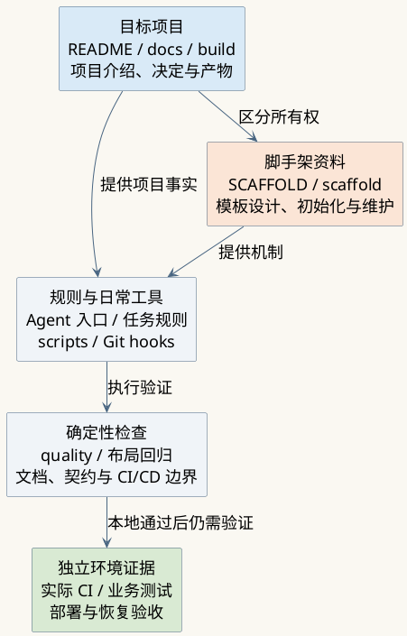
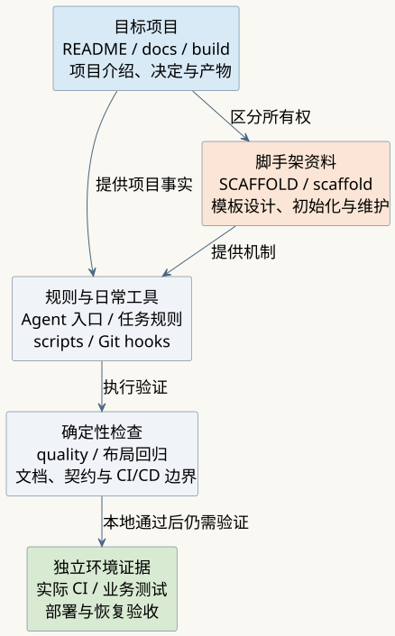
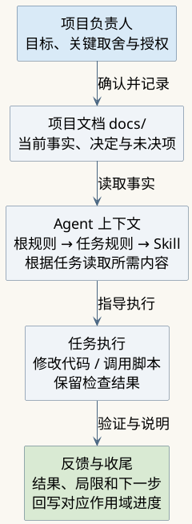
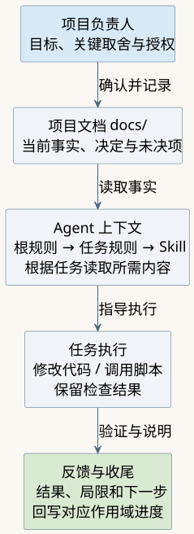
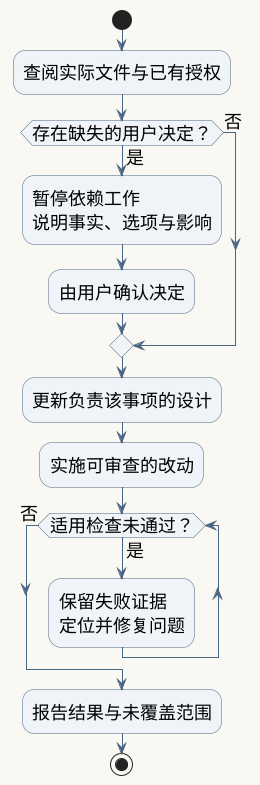
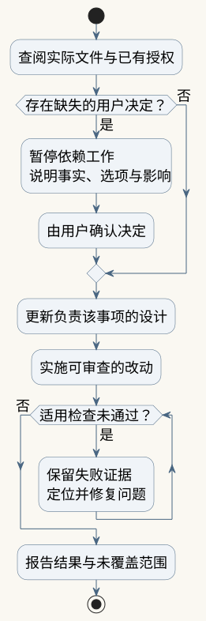
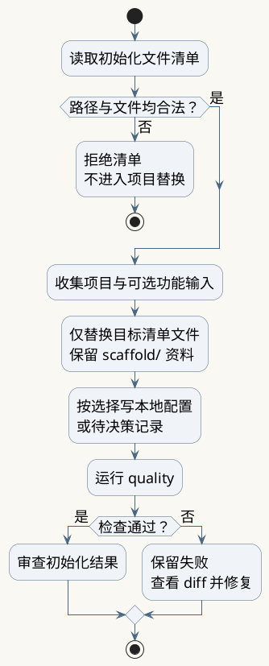
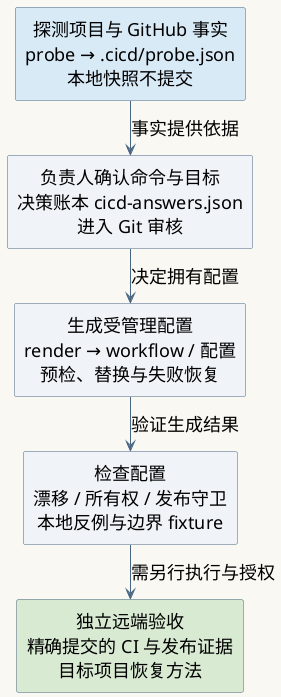
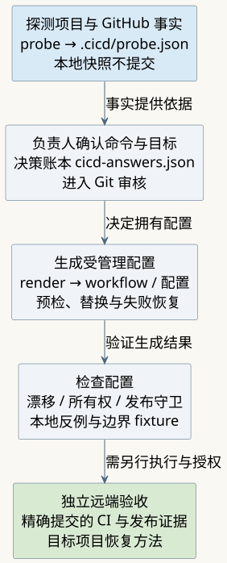

# AI 编码脚手架文章图表源

状态：active
最近更新：2026-11-04
适用范围：Scaffold 项目介绍与技术文章的静态示意图

本文件是图表的唯一可编辑源码，依据公开 `project-scaffold@4fc47cf` 与本轮本地核对记录。
图表示意职责和控制路径，不作为实机演示或执行成功证明。
本地使用 PlantUML 编译 SVG；公开页只加载静态图片，不运行图表插件。
每段源码紧跟其目标 SVG，使用既有 `scripts/quality/render-diagrams.mjs` 生成。

## 项目职责架构

## 上下文与执行职责

## 规范要求的单次任务流程

## 初始化写入边界

## CI/CD 配置与验收

