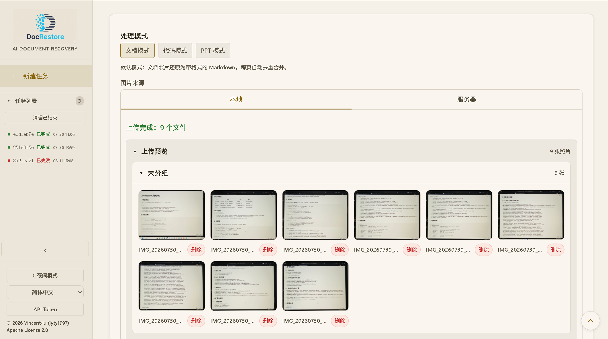
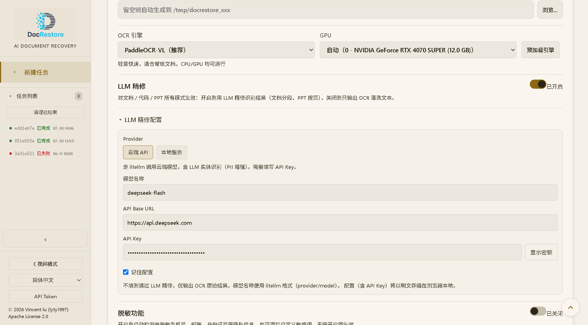
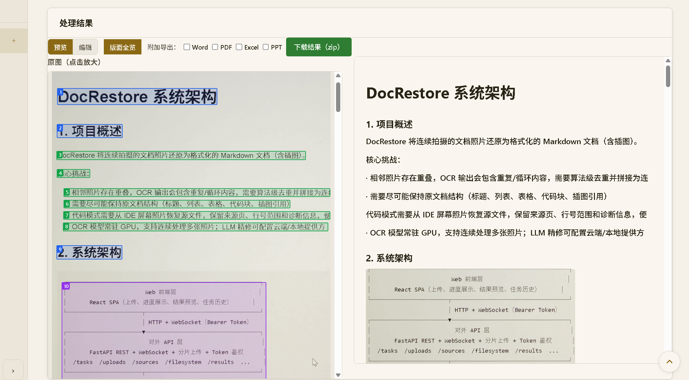

## 问题背景

DocRestore 最初要解决的不是“识别一张图里的文字”，而是把连续拍摄的文档照片重新组织成可审阅、可编辑的结果。相邻照片通常带有重叠区域，OCR 还会引入错字、循环片段、版面噪声和跨页结构丢失；如果只把每页文本顺次拼接，重复内容和错误会直接进入最终文档。

当前源码也接受 PDF，并把输入分成互斥的文档、代码和 PPT 三种模式。三种输入共享任务、OCR 和进度基础设施，但输出目标不同：文档模式形成带插图、公式和表格的 Markdown，代码模式恢复源文件与诊断索引，PPT 模式按原页序形成演示内容结果。这里介绍的是可在公开仓库中复核的工程实现，不代表 Axial Muse 已提供在线上传或公共处理服务。

## 能力与架构

系统分为 React Web 前端、FastAPI API、Pipeline 编排和处理组件四层。前端负责输入选择、配置、任务进度、结果审阅与下载；API 提供 REST、WebSocket、分片上传和任务接口；Pipeline 管理任务、阶段和进度；OCR、清洗去重、隐私处理、LLM 与输出则保留为边界清楚的组件。

文档模式采用生产者/消费者式流水线：OCR 逐页产生结果，清洗和可选正则脱敏后进入队列；下游一边做增量合并，一边切段并执行可选 LLM 精修。收齐页面后再完成缺口补充、整篇整理、程序化去重兜底和 Markdown 输出。代码与 PPT 使用独立分支，避免为了复用而把 IDE 行号、源文件分组或幻灯片页序强塞进普通文档模型。

OCR 引擎运行在独立子进程中，并通过统一协议接入 Pipeline。这样可以让 PaddleOCR 与 DeepSeek-OCR-2 使用各自环境，同时由 `EngineManager` 控制 GPU 引擎切换；LLM 也通过云端或本地兼容接口接入。任务与结果由 SQLite 持久化，实时进度优先走 WebSocket，连接失败时前端可退回轮询。

## 设计思路

- **先建立确定性基线，再引入模型增强。** 清洗、重叠去重、页边界、缺口标记和程序化兜底不依赖 LLM；模型精修是可选阶段，失败时应保留原始可审阅结果和可见警告，而不是把一次模型输出当成唯一事实。
- **按失败模式拆边界。** GPU OCR、普通文本处理、云端或本地 LLM、隐私脱敏与格式导出的依赖和故障形态不同，因此分别实现和测试。抽象的目的不是增加层数，而是让替换引擎、定位失败和限制并发时不必重写整条链路。
- **把来源线索留到人工审阅阶段。** 文档结果保留页边界和缺口信息，代码模式输出 `files-index.json`，文档界面通过 OCR 阶段生成的版面 sidecar 将正文块与来源图片联系起来。光标高亮没有把脆弱映射强行贯穿去重与 LLM 重排，而是在展示阶段对页内少量候选块做模糊匹配。
- **让模式差异显式存在。** 文档、代码和 PPT 的公共部分停在任务与 OCR 编排层，之后进入各自消费者；模式间互斥，能力缺失时明确失败，不静默退化成另一种模式。
- **降级必须可见。** 开发中的错误处理审计发现，输出链路曾存在“看似成功但实际缺页或缺图”的风险。后续实现把降级信息贯穿到任务结果和前端提示，并对日志中的查询 token 做脱敏。云端 LLM 由任务级出站策略执行实体替换或按配置阻断，但可选 PII 处理仍不等于对所有文档的隐私保证。

## 开发过程

第一阶段围绕连续文档照片建立最小处理链，先解决逐页 OCR、页内清洗、跨页重叠去重、合并和 Markdown 输出。随着真实输入增加，流水线从串行步骤演进为 OCR 生产者与 LLM 消费者并行的结构，用 GPU 串行锁保护引擎，同时让不占 GPU 的处理尽量与识别重叠。

第二阶段把同一基础设施扩展到不同恢复目标。代码模式增加 IDE 布局、行号识别、跨页源文件分组和诊断；PPT 模式保留页序并处理屏摄透视与版面；PDF 在摄取阶段逐页渲染，再进入既有处理链。多格式导出、所见即所得编辑、来源图片联动和版面全览随后补上“机器生成以后如何人工核对和修订”的闭环。

第三阶段主要不是继续堆功能，而是复核边界。进度记录显示，项目通过错误处理审计、代码审查和真实任务反馈修复了静默数据丢失、导出临时文件格式误判、查询 token 日志泄漏、PDF 坏页隔离等问题；也主动停止了收益不足的反向联动和行级 bbox 方案。后两项并非技术上完全做不到，而是经过试验后发现，LLM 重排后的正文缺少可靠的逐行对齐信号，低精度联动会比稳定的块级提示更误导。

## 主图证据范围

主图左侧是该公开快照中项目 README 的真实屏摄测试照片，右侧为同一照片经该提交的 OCR worker 本地复跑得到的连续原文节选，保留识别误差，未做 LLM 精修或人工纠错。它是处理结果的展示排版，不是应用界面截图；本次使用 PP-OCRv5 basic、CPU 和当前已安装的模型/依赖，不声称重建了 2026-07-03 的完整运行环境。

图中 README 保留拍摄时的旧安装说明，仅作为识别输入；安装和版本要求以本文固定快照的 README 为准。该素材证明单图本地 OCR 的实际输入与输出，不替代跨页去重、LLM 精修、PPT 或多格式导出的完整效果验收。

## 实机界面演示

以下三张图由项目作者提供，来自私有环境中的真实 Web 前端演示，依次展示输入、配置与结果审阅。它们尚未绑定精确源码提交、拍摄日期与完整运行参数，仅作为界面记录；本文的工程事实仍以前述固定快照为准。这组截图与上方 CPU、无 LLM 的主图复跑是不同的证据，不表示本站提供在线上传或公共处理服务。

### 输入与上传预览

上传区把待处理照片显示为缩略图，便于提交前检查输入。截图中的文档、代码和 PPT 模式入口展示了界面的任务分类，不代表所有模式都在这次演示中完成了处理。

### OCR 与可选精修配置

这张配置图显示 PaddleOCR-VL、GPU 选择和已开启的 LLM 精修配置，密钥字段处于遮蔽状态。它与主图使用的 PP-OCRv5 basic、CPU、无 LLM 条件不同；选择云端服务可能传输文档内容，实际处理仍应结合具体隐私要求配置并复核。

### 原图对照与结果审阅

结果区将带版面标注的原图与输出并列显示，便于人工对照；上方提供预览、编辑、附加导出选项和结果下载入口。截图证明这些界面在实机中可见，不替代逐项导出、来源联动精度或完整流水线的效果验收。

## 当前限制

- 当前没有公共在线体验；后端只用于本地开发和私有运行，不是公网多用户服务。现有 device token 是受控设备访问凭证，不是用户账号、租户隔离或公共登录系统。
- OCR、脱敏与 LLM 精修的效果依赖输入质量、模型和运行配置。选择云端 LLM 时可能发生外部数据传输；是否启用 PII 处理、实体检测是否完整以及最终结果是否可公开，都需要针对具体任务人工复核。
- GPU OCR、PDF 渲染和多格式导出依赖相应本地环境与工具，公开仓库存在代码不等于任意机器开箱即可完成全部模式。
- 本文核对的是 2026-07-03 的 `main` 快照。后续仓库变化不会自动成为本站事实；需要重新审核源码、测试和公开表达。
- 主图与实机截图已完成来源、隐私与公开使用审核；演示视频、封面和字幕尚未准备完成，作为后续增量。本站仅展示项目说明、源码与演示素材，不提供在线体验。

## 证据说明

- 本文以 DocRestore [`main@19ca6b1`](https://github.com/lyty1997/DocRestore/tree/19ca6b1444758d076d5c3e66b78f68d0066a4694) 为固定核对快照。项目定位与当前入口见该提交的 [README](https://github.com/lyty1997/DocRestore/blob/19ca6b1444758d076d5c3e66b78f68d0066a4694/README.md)。
- 分层、三条处理分支和并发模型由[架构设计](https://github.com/lyty1997/DocRestore/blob/19ca6b1444758d076d5c3e66b78f68d0066a4694/docs/zh/architecture.md)、[Pipeline 源码](https://github.com/lyty1997/DocRestore/blob/19ca6b1444758d076d5c3e66b78f68d0066a4694/backend/docrestore/pipeline/pipeline.py)与[后端测试](https://github.com/lyty1997/DocRestore/tree/19ca6b1444758d076d5c3e66b78f68d0066a4694/tests)交叉核对。
- 任务界面和人工审阅路径由[前端功能设计](https://github.com/lyty1997/DocRestore/blob/19ca6b1444758d076d5c3e66b78f68d0066a4694/docs/zh/frontend/features.md)、[前端装配源码](https://github.com/lyty1997/DocRestore/blob/19ca6b1444758d076d5c3e66b78f68d0066a4694/frontend/src/App.tsx)与[前端测试](https://github.com/lyty1997/DocRestore/tree/19ca6b1444758d076d5c3e66b78f68d0066a4694/frontend/tests)交叉核对。
- 设计反转、错误处理审计和范围收缩来自同一提交的[开发进度记录](https://github.com/lyty1997/DocRestore/blob/19ca6b1444758d076d5c3e66b78f68d0066a4694/docs/zh/progress.md)；隐私相关表述另核对了[云端出站门禁源码](https://github.com/lyty1997/DocRestore/blob/19ca6b1444758d076d5c3e66b78f68d0066a4694/backend/docrestore/llm/egress_gate.py)。
- [本站项目展示与未来体验设计](https://github.com/lyty1997/AxialMuseWebsite/blob/main/docs/projects/docrestore-experience.md)继续约束未实施的在线体验、安全和数据边界，并记录主图来源、原始摘要和独立公开批准；源码交叉核对与真实视觉证据各自保留验收边界。

## 复盘

DocRestore 的可复用经验不是“把 OCR、LLM 和导出接在一起”，而是让确定性处理、模型增强、来源线索和人工复核各自有位置。真实输入不断暴露文档和实现之间的偏差，因而源码、测试、进度记录和界面证据必须互相校验；只读一份架构文档会漏掉已经完成的功能，也可能把后来放弃的方向写成承诺。

对主站而言，可信展示同样需要保持边界：先公开能够追溯到精确提交的工程事实，再补经过隐私与版权审核的真实界面；源码存在、私有环境可运行和公网服务可用是三件不同的事。
