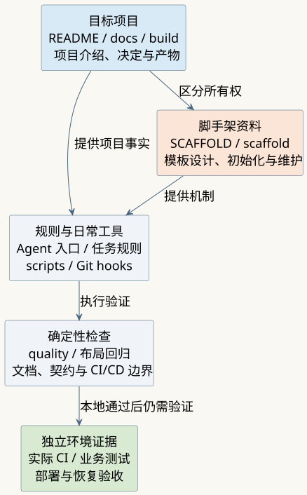

## 问题背景

新项目通常缺少统一的设计真相源、Agent 执行规则和自动质量门禁。使用 AI 编码工具后，代码可以很快生成，但项目为什么这样设计、哪些决定已经确认、改完应该验证什么，仍需要有人持续维护。

VibeCoding Project Scaffold 面向希望用 AI 持续开发项目的个人开发者和小团队，提供一套可以复制、初始化和裁剪的工程起点：用文档保存事实，用规则装配上下文，用脚本检查能稳定判断的问题，再把同一套检查接入 Git hooks 与 CI。

## 能力与架构

脚手架把“目标项目”和“脚手架自身”分开管理。根目录的 README 和 `docs/` 留给目标工程；`SCAFFOLD.md` 是脚手架说明，`scaffold/` 保存模板设计、参考资料、初始化和维护用例。日常使用的工程工具继续放在根 `scripts/`。

_架构示意图：表示仓库职责与检查关系，不是实机运行截图。_

| 能力 | 当前实现 |
| --- | --- |
| 初始化 | `npm run init` 调用 `scaffold/scripts/init.mjs`，按清单替换目标项目占位符 |
| 项目上下文 | `docs/` 保存项目事实；`AGENTS.md`、`CLAUDE.md` 和规则索引按任务路由执行要求 |
| 质量检查 | `npm run quality` 覆盖脚本语法、文档与双语一致性、契约、常见密钥形态、静态入口和 CI/CD 约束 |
| 本地与远端反馈 | Git hooks 检查提交；已有 CI 配置在 Ubuntu、Windows 运行基础门禁，并独立检查图表与 workflow |
| CI/CD 接线 | 探测项目事实，由确认后的决策账本生成 workflow，再检查漂移与安全边界 |
| 文档协作 | Archify、PlantUML、便携 HTML 导出和可选跨机预览，按需准备各自环境 |

## 如何开始

1. 复制仓库，在符合 `package.json` 要求的 Node.js 环境中运行 `npm run init`。
2. 填写项目定位与仓库信息，按实际需要选择跨机预览和 CI/CD；暂不配置 CI/CD 时，初始化器会写入待决策记录。
3. 编辑根 README 与 `docs/`，把占位内容替换为真实事实，确定技术栈，再补业务代码和测试。
4. 启用 Git hooks，运行质量检查；需要目标项目构建、发布或 Release 时，再配置对应账本和环境。

基础质量工具使用 Node.js 内置能力，不需要安装第三方 npm 包。PlantUML、便携文档导出与 workflow lint 等能力分别需要 Java/JAR、Pandoc 或官方检查工具，不能把它们与基础门禁的依赖要求混为一谈。

## 关键取舍

- 不绑定前端或后端框架，让具体项目按需求选择技术栈。
- 目标工程事实放在 `docs/`，脚手架历史和示例放在 `scaffold/`，避免新项目继承模板维护历史。
- 将确定性检查交给脚本，将产品取舍和授权交给负责人；规则本身不能保证 Agent 一定正确执行。
- 项目采用 Apache License 2.0；具体第三方工具仍按各自许可证和运行条件使用。

## 当前限制

- 模板提供工程组织与工具入口，使用者仍需完成真实产品设计、业务实现和部署配置。
- `npm test` 仍是提示占位，不能作为业务测试通过的证据。
- CI/CD 生成器的本地反例检查覆盖配置边界；目标环境能否构建、发布和恢复，需要在该项目中独立验收。
- 跨机预览依赖实际主机、路径和 SSH 配置。本轮未操作预览服务器或公开服务。
- 当前提供源码，不提供在线初始化器，也不收集访问者输入。

## 证据说明

本稿于 2026-11-04 对照指定本地项目，并将核心文件与公开 [`4fc47cf` 版本](https://github.com/lyty1997/project-scaffold/tree/4fc47cfbe508023df2bdaefd61a8a87532a297bf)逐文件核对。可从该版本的[脚手架说明](https://github.com/lyty1997/project-scaffold/blob/4fc47cfbe508023df2bdaefd61a8a87532a297bf/SCAFFOLD.md)、[命令清单](https://github.com/lyty1997/project-scaffold/blob/4fc47cfbe508023df2bdaefd61a8a87532a297bf/package.json)和[初始化实现](https://github.com/lyty1997/project-scaffold/blob/4fc47cfbe508023df2bdaefd61a8a87532a297bf/scaffold/scripts/init.mjs)追溯上述能力。两份跨机预览 PowerShell 脚本存在本地差异，其修改未作为公开版本能力写入本稿。

图表是对源码结构的解释。执行检查的范围、通过结果与未验证部分见[关联技术文章](../../writing/ai-coding-scaffold-engineering-loop/index.md)，不从图表或配置文件推导真实部署成功。

## 复盘

可复用的重点是让每个项目有地方保存事实、有明确的工具入口，也能发现不一致。复制模板只是起点；项目自己的设计、测试和环境证据，决定了这套结构是否真正适用。
