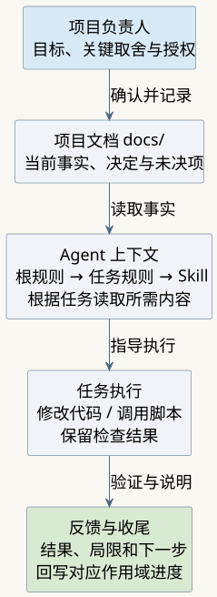
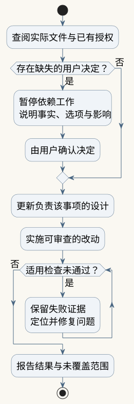
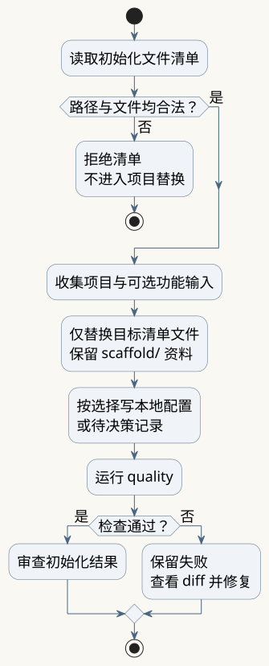
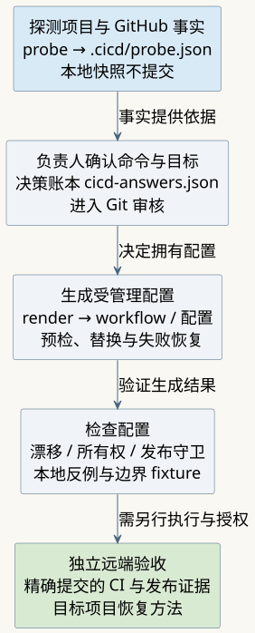

[项目介绍](../../projects/vibecoding-project-scaffold/index.md)说明这套脚手架适合谁、提供哪些入口。本文进一步解释几个已经落到代码里的选择：项目事实和模板历史如何分开、初始化器能写什么、Agent 如何找到规则，以及 CI/CD 如何从事实走到受控配置。

## 问题背景

一次 AI 编码对话可以完成局部修改，但跨任务维护还需要回答：设计依据在哪里？哪些命令真实存在？模板中的例子是否已经变成项目事实？质量检查通过，到底说明了什么？

如果这些问题只靠每次对话重新解释，后续任务很容易沿用旧信息。VibeCoding Project Scaffold 用版本化文档、按任务加载的规则和确定性工具保存这些边界。它并不执行一个无人值守的“读需求到生产上线”流程，责任人、Agent 和检查工具各有职责。

> 核对范围：2026-11-04 的指定本地工作区快照。核心实现与公开
> [`4fc47cfbe508023df2bdaefd61a8a87532a297bf`](https://github.com/lyty1997/project-scaffold/tree/4fc47cfbe508023df2bdaefd61a8a87532a297bf)
> 逐文件一致；差异为两份维护进度与两个跨机预览 PowerShell 脚本。本文不将这两个脚本的本地修改作为公开版本能力。以下图表均为源码示意，不是运行截图。

## 先分清项目事实与脚手架资料

当前布局保留 clone 后初始化的使用方式，同时明确两套所有权：

| 位置 | 负责什么 |
| --- | --- |
| 根 README、`docs/` | 目标工程的介绍、设计、契约与进度 |
| `SCAFFOLD.md` | 脚手架使用和维护入口 |
| `scaffold/docs/` | 脚手架自身的设计、历史、图表和参考配方 |
| `scaffold/scripts/`、`scaffold/examples/` | 初始化、框架回归与明确标注的样例 |
| 根 `scripts/`、hooks、workflows | 工程持续使用的工具和接线 |
| `build/`、`scaffold/build/` | 各自作用域的忽略产物 |

这次隔离解决了一个具体问题：复制新项目时，脚手架自己的决策和维护记录不应混入新项目的历史。持续使用的检查工具则保留原入口，不需要为两个文档根维护两份实现。

探测器也遵守这个边界。`detectSourceExtensions()` 排除 `scaffold/`、规则、文档及工具目录，让参考 HTML 和回归脚本不参与目标项目源码语言计数。这个排除只针对源码扩展名统计，不能推广成“探测器忽略所有根目录构建标记”。

## 上下文如何进入一次任务

`AGENTS.md` 保存事实来源、授权边界和基本推理要求；规则索引再按任务加载 Markdown、前端、CI/CD 等细则；有专门流程的工作交给对应 Skill。Claude 入口也通过引用连接这些规则。

_图 1：上下文与执行职责。箭头表示读取、执行或回写关系。_

文档负责解释项目，脚本负责判断可以稳定检查的性质。例如，脚本能验证链接是否存在、生成配置是否漂移，却不能判断某项产品定位是否值得实施。Agent 根据任务查证和修改；涉及缺失的用户决定时，暂停依赖该决定的工作。

_图 2：规范要求的任务流程，不是自动编排器。规则存在不等于每次执行都已符合规则。_

## 初始化器怎样限制写入

正常入口仍是 `npm run init`。

当前命令调用 `scaffold/scripts/init.mjs`。与遍历整个仓库做文本替换不同，初始化器先读取 `scaffold/project-files.json`，只处理其中显式列出的目标工程文件。

写入前逐项检查路径：拒绝绝对路径、目录回退、符号链接、重复条目、非普通文本文件，以及指向 `scaffold/` 和 SCAFFOLD 说明的路径。全部清单通过后才询问并替换项目名、品牌、仓库和版权归属等占位值。

初始化器支持终端问答，也支持按行读取非 TTY 输入，供自动化 fixture 使用。可选的跨机预览会生成被忽略的本地配置；暂缓 CI/CD 则在目标工程的待决策文档中留下记录。

_图 3：初始化的写入边界；清单检查不等于全部写入具备事务性。_

这里需要保留一个实现限制：初始化器随后逐文件写入，再运行质量检查。它不是整库原子事务；写入或后置质量检查失败时，不能承诺自动恢复全部文件。因此应在可审查、可恢复的工作区初始化，失败后查看 diff。

`check:scaffold` 在一次性副本中验证初始化，比较脚手架资料的摘要，并覆盖非法路径、符号链接、缺失译本、源文件计数和后续项目定制。目标项目初始化后，该布局维护套件按 `package.json` 的真实项目名显式跳过；普通工程质量检查继续运行。它不会因为文档里出现示例占位符而把已初始化工程重新当作模板。

## CI/CD：事实、决定和生成物分开

CI/CD 部分由三类数据组成：

1. `scripts/cicd/probe.mjs` 收集构建标记、已有命令、源码分布和 GitHub 状态，将事实快照写入被忽略的 `.cicd/probe.json`。远端查询是读取操作，本地会写快照，因此不能称为完全无写入。
2. `docs/contracts/cicd-answers.json` 保存确认后的构建、测试、部署和发布决定。探测到某种语言或 Dockerfile，不能据此猜测业务命令和发布目标。
3. `scripts/cicd/render.mjs` 由账本生成受管理 workflow；检查器验证漂移、安全边界和关联状态。

_图 4：事实快照提供依据，决策账本拥有配置；本地配置验证与目标环境验收分开。_

生成器为管理的文件写入标记和账本摘要。写入前检查同名手写文件、符号链接、残留文件和所有权冲突；相邻临时文件准备好后逐个替换，并保留备份。fixture 通过强制后续替换失败，验证已经替换的内容被恢复。

这与初始化器不同：CI/CD 生成器有逐文件替换失败的恢复路径，但不因此获得并发任意写入或任意部署成功的保证。

部署步骤通过 `deployStep` 显式区分发布和准备，生成配置中的 `dry_run` 守卫限制实际发布。Release Please 的配置由账本管理，而 manifest 是随 Release PR 前进的运行状态；已有 bundle 丢失 manifest 时应恢复状态，不能用初始值重置版本。

## 质量检查能证明什么

基础 `npm run quality` 使用 Node.js 内置能力，覆盖语法、文档、双语配对、便携文档边界、契约词表、常见密钥形态、静态入口和 CI/CD 检查。静态入口不存在或目标 CI/CD 账本未建立时，相关目标检查可以按既有设计显式跳过；跳过不能表述为该目标已经验收。

已有 CI 配置在 Ubuntu、Windows 上运行基础质量与布局回归；图表、workflow lint 是独立 job。本地启用 hooks 后，pre-commit 运行基础质量，commit-msg 检查提交主题。配置存在只能证明接线意图，某次运行是否成功仍需检查该次实际证据。

依赖也按入口区分：基础检查无需第三方 npm 包；PlantUML 需要 Java 与 JAR，便携 HTML 导出需要 Pandoc，workflow lint 使用 actionlint 等工具。不能将“基础零 npm 依赖”写成所有能力都没有环境要求。

## 本次验证与未覆盖范围

本次在隔离副本中执行指定工作区快照，保留来源目录及其原有改动：

- 基础 `npm run quality` 与独立布局回归用于核对现有实现；其中 CI/CD fixture 检查生成、漂移和失败恢复等反例。
- 本站图表单独本地编译，检查实际渲染；这些结果只证明新稿和示意图的可用性。
- 第一轮副本缺少托管环境隐藏的 Agent discovery 文件，导致双语检查拒绝；从来源 Git index 在副本中补齐后重新执行。该问题属于副本装配，不以跳过检查解决。

本稿保留以下边界：

- `npm test` 仍是提示占位，不代表有业务测试。
- 本轮没有触发目标项目的远端 CI、实际部署、Release 或回滚。
- 本地 fixture 成功不等于每个技术栈都能开箱即用，目标项目仍需自己的环境与业务证据。
- 规则与提示词的源码审查不能代替模型行为评测，也没有据此测量开发效率提升。

## 复盘

这套实现最值得复用的是所有权和证据边界：项目事实、模板历史、运行快照和确认后的配置分别保存；初始化和生成器使用不同的写入策略；基础质量、业务测试与远端验收分别给出结论。

维护时，先把重复问题归因到事实缺失、规则冲突、工具缺陷或环境差异。能够稳定检查的约束再进入脚本；需要判断的部分保留在设计与审核中。这样的结构让后续任务能够找到依据，也让失败停在可定位的位置。

## 参考来源

以下链接均固定到本次核对版本，访问日期为 2026-11-04：

- [脚手架使用说明](https://github.com/lyty1997/project-scaffold/blob/4fc47cfbe508023df2bdaefd61a8a87532a297bf/SCAFFOLD.md)。
- [目录所有权设计](https://github.com/lyty1997/project-scaffold/blob/4fc47cfbe508023df2bdaefd61a8a87532a297bf/scaffold/docs/architecture/scaffold-layout.md)。
- [初始化器](https://github.com/lyty1997/project-scaffold/blob/4fc47cfbe508023df2bdaefd61a8a87532a297bf/scaffold/scripts/init.mjs)与[隔离回归](https://github.com/lyty1997/project-scaffold/blob/4fc47cfbe508023df2bdaefd61a8a87532a297bf/scaffold/scripts/quality/check-layout-fixtures.mjs)。
- [探测器](https://github.com/lyty1997/project-scaffold/blob/4fc47cfbe508023df2bdaefd61a8a87532a297bf/scripts/cicd/probe.mjs)、[生成器](https://github.com/lyty1997/project-scaffold/blob/4fc47cfbe508023df2bdaefd61a8a87532a297bf/scripts/cicd/render.mjs)与 [CI/CD 检查器](https://github.com/lyty1997/project-scaffold/blob/4fc47cfbe508023df2bdaefd61a8a87532a297bf/scripts/quality/check-cicd.mjs)。
- [命令清单](https://github.com/lyty1997/project-scaffold/blob/4fc47cfbe508023df2bdaefd61a8a87532a297bf/package.json)与 [CI 配置](https://github.com/lyty1997/project-scaffold/blob/4fc47cfbe508023df2bdaefd61a8a87532a297bf/.github/workflows/ci.yml)。
